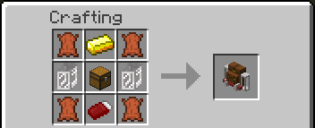
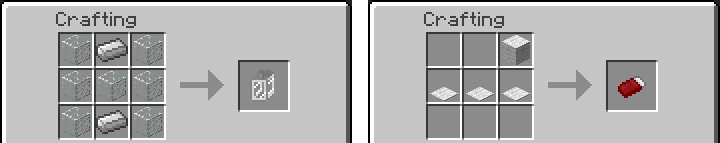
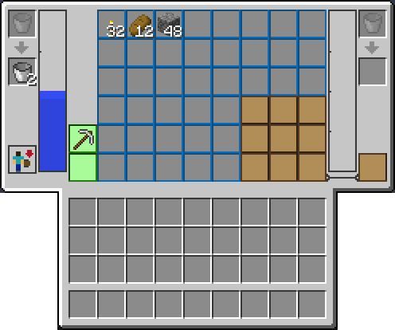
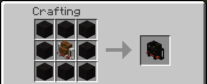

# Backpacks

The Adventure Backpack is worn on your back and placed as a block when you want to leave it. There are 76 types. They share the same storage; the type changes the look and, for 20 of them, adds an ability.

| | |
|---|---|
| Type | Wearable item and placeable block |
| Stack size | 1 |
| Obtained by | Crafting (70 types), dungeon and village loot, villager trades, lightning |
| Config section | `backpack`, `abilities`, `worldgen` |

## Crafting the Standard backpack

Every other backpack starts from the Standard one. The recipe uses leather, a gold ingot, a chest, two Backpack Tanks and a Sleeping Bag, and the last two are components you craft first.

Any gold ingot works, including ones from other mods.

## What is inside

Open the backpack with B while you wear it, or right click with it in your hand, and you get:

- 39 storage slots. A backpack cannot hold another backpack.
- 2 tool slots, which only take tools. The [tool swap](Controls#swapping-tools) trades them with the tool in your hand.
- 2 tanks, 4000 mB each by default (see [Configuration](Configuration#backpack-backpack)). Each tank has its own pair of slots for buckets, bottles and other fluid containers. See [Fluids and Hose](Fluids-and-Hose).
- A 3x3 crafting grid with its result slot.

## Turning it into another type

Put a Standard backpack in the middle of the crafting grid and the type's items around it. The new backpack keeps the contents and the fluids of the old one. Only a Standard backpack works as the base.

The pattern depends on the type: the 16 colours, Pig, Egg, Leather and a few more use eight of one item around the backpack, the others use a mix. Look up the exact grid in your recipe viewer, or use the "Made with" column below to know what to collect.

Crafting the Dragon backpack gives you the Dragon Egg back, so it is not used up.

## Wearing, placing and picking up

- Hold the backpack and right click in the air: the window opens. Press **Equip** to put it on, **Unequip** to take it off.
- Hold Sneak while pressing Equip to swap with the one you already wear.
- Right click a block with the backpack in your hand to place it.
- Break a placed backpack to get the item back with everything inside. Break it while sneaking and it goes straight onto your back.
- Right click a placed backpack to open it. Its window has a button to deploy the sleeping bag.

You can wear one backpack, copter pack, jetpack, scuba gear or flamethrower pack at a time. They share the same place on your back. For more questions see the [FAQ](FAQ).

## The types

"Made with" lists the items that go around the Standard backpack. Types with a dash are not craftable.

### With an ability

| Backpack | While worn | Made with |
|---|---|---|
| Bat | Night vision. | Not craftable. Found in dungeon chests and mineshaft corridors. |
| Squid | Water breathing and night vision while you are in water. | Blue wool, ink sacs |
| Pigman | Fire resistance. | Not craftable. A Pig backpack struck by lightning while worn. Optionally in desert pyramid chests and from villagers (see below). |
| Dragon | Fire resistance, Strength II and Regeneration I. Water breathing and night vision while in water. | End stone, Dragon Egg, obsidian, ender pearls |
| Cactus | Fills both tanks with water while you stand in water or in the rain. A placed Cactus backpack fills in the rain and pricks what touches it. | Cactus, green dye, sand |
| Melon | Fills both tanks with melon juice in water or rain, as the Cactus does with water. | Melon slices, melon block, melon seeds |
| Pig | Oinks now and then, up to a minute apart. | Raw porkchop |
| Slime | Leaves a slime trail and sound when you sprint, makes you slide a little when you stop, and gives Speed II on a full moon night. | Slimeballs |
| Chicken | Lays an egg every few minutes. | Feathers, gold nuggets, egg |
| Creeper | Sneak next to another player and it hisses. Explodes when you die, without breaking blocks. | Gunpowder, Creeper head, 2 TNT |
| Cow | Eats wheat from the backpack and makes milk in a tank: 16 wheat for one bucket. | Beef, leather, milk bucket |
| Mooshroom | The same as the Cow, with mushroom stew. | Red and brown mushrooms, mushroom stew, mycelium |
| Wolf | Angry wolves that target you calm down. | Bones, white wool |
| Ocelot | Creepers run away from you. | Raw fish, yellow wool |
| Rainbow | Eat a golden apple to start the Nyan run: about 2.5 minutes of Speed III and Jump Boost III, with a rainbow trail and the song. | The seven rainbow dyes, a Cat music disc |
| Sunflower | Feeds you in daylight, a drumstick every two minutes. | Sunflowers |
| Skeleton | Bows take their arrows from the backpack. A bow can go in the tool slots. | Bones, Skeleton skull, bow, arrows |
| Iron Golem | No fall damage. | Not craftable. Found in village blacksmith chests. |
| Spider | Tame spiders with a spider eye: they follow you for good, climb after you and carry you. See [Taming spiders](#taming-spiders). | Spider eyes, string, ladders |
| Blaze | You do not burn in fire or lava, and what you punch catches fire for 4 seconds. | Blaze rods, fire charge, blaze powder, lava bucket |

You can turn the abilities of the backpack you wear off and on with a key of your own, without taking the backpack off. The key is not bound by default. See [Controls](Controls#the-abilities-key).

The Cactus and Melon timings, the Cow and Mooshroom amounts and every other number above are in [Configuration](Configuration#abilities-abilities).

### Taming spiders

A tame spider is a pet like a tame wolf: it stays with you for good, follows you up walls and towers, and with the Spider backpack on you can ride it.

To tame one, wear the Spider backpack and right click a wild spider with a spider eye. A try works one time in three, like taming a wolf, and every try uses up an eye. On a failure you see smoke, on a success hearts. A tame spider has more health than a wild one: 10 hearts instead of 8, and taming fills them.

> Screenshot: a player with the Spider backpack on, a spider eye in hand, and the hearts over the spider that has just been tamed. File: images/backpacks-5.png

**What you do with it**

All of these are a right click on your own tame spider. Other players' spiders do nothing for you.

| You | Result |
|---|---|
| Right click, Spider backpack on | Gets on it. Press jump to make it jump. |
| Sneak and right click, empty hand | Makes it sit down, or stand up again. A sitting spider lies flat with its legs stretched out and stays where it is. |
| Right click, rotten flesh in hand | Heals it by 2 hearts and uses up the flesh. Nothing happens if it is not hurt. |
| Sneak and right click, spider eye in hand | Sets it free. It turns back into a normal wild spider, and you can tame another one. |

Sneaking and right clicking with something other than a spider eye also makes it sit or stand.

> Screenshot: a tame spider lying flat on the ground, legs stretched out, with the owner next to it. File: images/backpacks-6.png

**How it behaves**

- It follows you. When you get far away it walks to you, and if it cannot reach you it jumps next to you, like a wolf.
- It climbs. If you are on a tower, a roof or a ceiling, it goes up the wall to you, and it goes down a cliff to you if you are below. It only climbs when it needs to, so it does not hang on trees and walls while it wanders.
- It stays. A tame spider does not despawn, and it is not set free when you log out, die or change dimension. A spider you leave in another dimension waits there, and does not follow you until you are back in the same one.
- It does not fight for you. A tame spider never attacks, even when something hits you.
- It counts against a limit. You can have two tame spiders at a time, saved with the world, and a chat message tells you when you are at the limit. A spider that dies or that you set free no longer counts.
- Without the Spider backpack, your spiders still follow you, sit down and heal, but nobody can ride them. If you take the backpack off while riding, you get off.
- Only the plain spider can be tamed. Cave spiders and spiders from other mods cannot. Spiders nobody tamed never become friends on their own and despawn as usual.

The limit, the taming chance, the item you tame and heal with, their health, how far they follow, how high they climb and when they jump to you are all in [Configuration](Configuration#spider-backpack-abilitiesspider). `abilities.spider.smartClimb` set to false makes them climb any wall they touch, like a wild spider.

### Blaze backpack

The Blaze backpack gives you the fire resistance of a magma cube: fire and lava do not burn you. Your punches set what you hit on fire for 4 seconds, mobs and players alike. A punch is an empty hand or an item that is not a weapon, like a block, food or a stick. Swords, tools and bows do not set things on fire.

### Placed backpacks

A few types do something when placed:

- Glowstone gives off light.
- Redstone gives off a redstone signal.
- Bookshelf counts as ten bookshelves for an enchanting table, when placed where a bookshelf would go.
- Cactus pricks anything that touches it, and fills with rain.
- Melon fills with rain, with melon juice.

### Appearance only

These have no ability. They are craftable from the Standard backpack.

| Backpack | Made with |
|---|---|
| Black, Blue, Brown, Cyan, Gray, Green, Light Blue, Light Gray, Lime, Magenta, Orange, Pink, Purple, Red, White, Yellow | Wool of that colour |
| Bookshelf | Bookshelves, books |
| Brown Mushroom | Brown mushrooms |
| Cake | Eggs, cake, wheat, sugar, milk bucket |
| Carrot | Carrots |
| Chest | Chests, planks |
| Coal | Coal, coal blocks |
| Cookie | Cookies, cocoa beans, wheat |
| Diamond | Glass, diamond block, diamond |
| Egg | Eggs |
| Emerald | Glass, emerald block, emeralds |
| End | End stone, eyes of ender |
| Enderman | Black wool, ender pearls |
| Ghast | Ghast tears, fire charge, gunpowder |
| Glowstone | Glowstone blocks, glowstone dust |
| Gold | Glass, gold block, gold ingots |
| Haybale | Hay bales |
| Horse | Leather, saddle, hay bales |
| Iron | Glass, iron block, iron ingots |
| Lapis | Glass, lapis block, lapis lazuli |
| Leather | Leather |
| Magma Cube | Magma cream, lava bucket |
| Nether | Quartz, netherrack, nether wart, lava bucket |
| Obsidian | Obsidian |
| Overworld | Light blue wool, grass blocks, cobblestone |
| Pumpkin | Pumpkins, pumpkin seeds |
| Quartz | Quartz blocks, quartz |
| Red Mushroom | Red mushrooms |
| Redstone | Redstone blocks, redstone dust |
| Sandstone | Sandstone, chiseled sandstone |
| Sheep | White wool, pink wool |
| Silverfish | Light gray wool, cracked stone bricks |
| Snow | Ice, snow layers, snowballs |
| Sponge | Sponges |
| Wither | Wither Skeleton skulls, soul sand, nether star, diamond |
| Wither Skeleton | Bones, stone swords, coal, Wither Skeleton skull |
| Zombie | Rotten flesh, Zombie head |

Of these, Diamond becomes Electric if lightning strikes you while you wear it. Electric has no ability and no recipe.

### Other ways to get a backpack

| Backpack | How |
|---|---|
| Villager | A Librarian or a Priest trades it for 10 emeralds and a Standard backpack. A Blacksmith trades it for 10 emeralds and an Iron Golem backpack. |
| Iron Golem | Found in village blacksmith chests. |
| Bat | Found in dungeon chests and mineshaft corridors. |
| Pigman | Lightning on a worn Pig backpack. With `worldgen.pigmanBackpacks` on, also in desert pyramid chests and in villager trades. |
| Standard | In the bonus chest, if `worldgen.bonusChestBackpack` is on. |
| Deluxe | Creative tab only. |

Every type is in the Adventure Backpack creative tab.

## See also

[Fluids and Hose](Fluids-and-Hose), [Controls](Controls), [FAQ](FAQ), [Configuration](Configuration)
