# Crossbow

The Clockwork Crossbow is a repeating crossbow with three modes. In repetition mode it fires a magazine of six bolts one after another while you hold the right mouse button. In grappling hook mode it shoots a hook that pulls you to a block. In sniper mode, with a bipod down, it fires one strong, straight bolt. It takes reusable Crossbow Magazines, which you fill with arrows or Crossbow Bolts, and you change the mode with a key.

| | |
|---|---|
| Type | Weapon |
| Stack size | 1 (Crossbow Magazine: 16, Crossbow Bolt: 64) |
| Obtained by | Crafting |
| Key | Crossbow Mode (V) |
| Config section | `crossbow`, `crossbow.magazine`, `crossbow.ammo`, `crossbow.grapple`, `crossbow.sniper`, `enabled.crossbow` |

## Crafting

The crossbow is built around a clock, a bow, strings and iron. Any planks work.

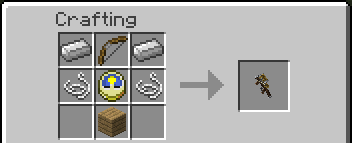

An empty Crossbow Magazine takes an iron ingot, two sticks and a string.

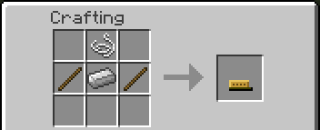

A Crossbow Bolt takes an iron ingot, a stick and a feather, in a column, and makes four. It is ammunition for the magazine and does nothing on its own.

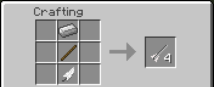

Two recipes fill a magazine in the crafting grid, so you can make loaded magazines without loading them by hand. In the first, six arrows, an iron ingot and two sticks make a magazine already loaded with six arrows. The second is shapeless: a magazine and some ammunition of one kind, up to the room the magazine has left, make the magazine with those charges added. The magazine must be empty or hold the same kind. Both can be turned off in the configuration.

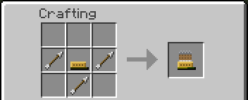

## The Crossbow Magazine

The magazine is not used up. It holds six charges, and you load it again when it is empty. It holds one kind of ammunition at a time: arrows or Crossbow Bolts. An empty magazine takes whichever ammunition it finds first in your inventory, hotbar first, and then only that kind until it is empty again.

To load it, hold the magazine in your hand and hold right click. One charge goes in from your inventory with each click sound, about five a second, until the magazine is full or you run out of that ammunition. If you have none, you hear a click and get a message that says what is missing. In creative mode you do not need ammunition.

The tooltip of the magazine shows its charges, what it is loaded with, and a bar that fills as it empties. Empty magazines stack together, and loaded ones stack when they hold the same kind. If you hold a stack of several, one stays in your hand and the others go back to your inventory.

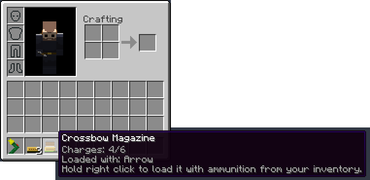

## Loading the crossbow

Hold the crossbow and right click. If it has no bolts left, it takes the first loaded magazine in your inventory, hotbar first. The spent magazine comes back to your inventory empty, or falls at your feet if the inventory is full, and you can load it again. Loading takes a second and a half, and the crossbow does not fire while it loads.

To change the magazine before it is empty, sneak and right click. The magazine in the crossbow comes back with the charges it has left, and the crossbow takes another loaded one. This works only while another loaded magazine is in your inventory.

Without a loaded magazine you hear a click, get the message "no loaded magazine" at most once a second, and the empty magazine goes back to your inventory. In creative mode you do not need magazines.

The reload shows on the crossbow, in first and third person. The spent magazine comes out of the slot on top and falls to the right, and the new one rises from your left hand and goes in through the slot.

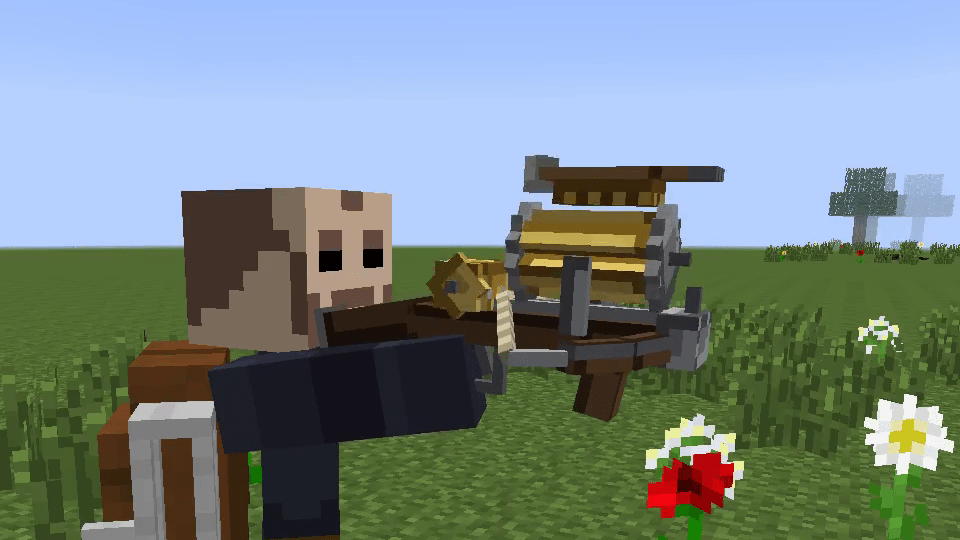

The tooltip of the crossbow shows how many bolts are left and the current mode. In third person the player holds the crossbow with both hands and aims along it.

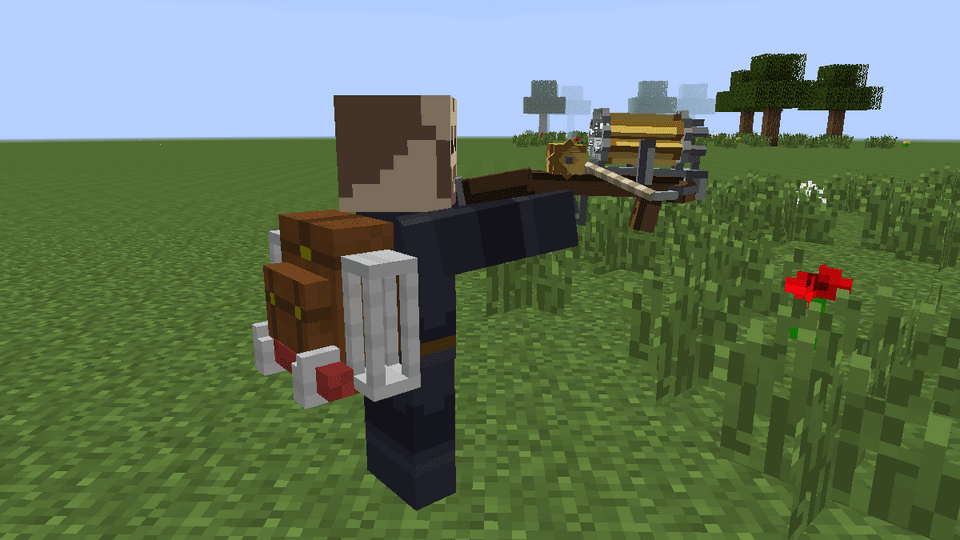

## Ammunition

A magazine takes the items of `crossbow.ammo.list`. By default these are the vanilla arrow and the Crossbow Bolt.

- A bolt fired from a magazine of arrows does 4 damage, two hearts.
- A bolt fired from a magazine of Crossbow Bolts does half as much again: 6 damage, three hearts. The same factor applies to the sniper mode.
- Any other item that a server adds to the list does the damage of an arrow.

A bolt stuck in a block cannot be picked up again by default. If the server allows it, you get an arrow back, not a Crossbow Bolt.

## Changing the mode

Press the Crossbow Mode key (V by default) with the crossbow in your hand. The modes go in a circle: repetition, grappling hook, sniper, and back to repetition. The mode is kept in the crossbow, shows in its name in the hotbar, and the tooltip tells you which key changes it.

A mode that a server has turned off is skipped. A crossbow left in a mode that is off fires in repetition mode.

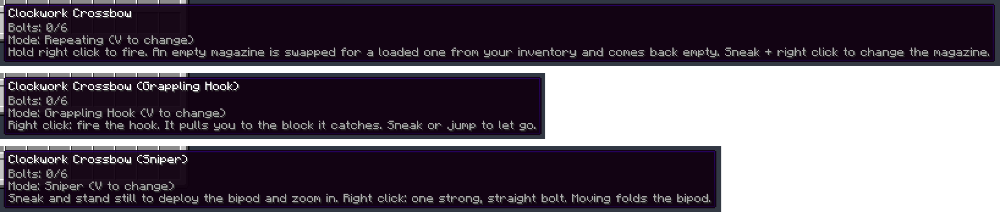

## Repetition mode

This is the default mode. Hold the right click and the crossbow fires a bolt every fourth tick, five a second, until the magazine is empty. When it is empty, the next click loads another magazine.

A bolt flies as fast as a fully drawn bow, and every bolt of a burst hits, even against a mob that was just hurt.

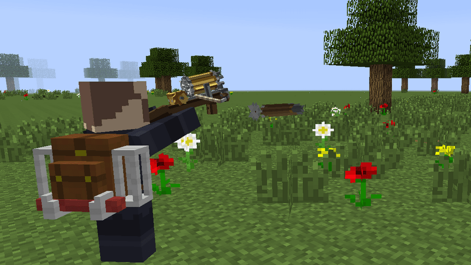

## Grappling hook mode

Right click and the crossbow shoots a hook with a rope. The hook flies straight, without falling, and catches the first solid block it meets. Then it pulls you towards that spot, faster than you can sprint, until you let go or arrive.

- The hook reaches 32 blocks. If it gets that far without catching anything, it comes back.
- The hook lets go when you get close to it, when you sneak, when you jump, after three seconds of pulling, when the block it holds is gone, and when you change the mode or hold something else.
- While the hook is out, clicking does nothing. Let go first.
- Each shot costs one charge from the magazine, and after it you wait a second before the crossbow can fire or reload again.
- You take no fall damage from the pull, and a fall that starts when the hook lets go counts from there.

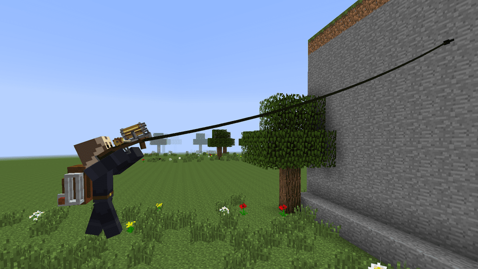

## Sniper mode

Sneak and stand still on the ground to put the bipod down. The view zooms in about three times. While the bipod is down, right click fires one bolt that is stronger and faster than a normal one and flies straight, without spread: 12 damage, six hearts, and about a second and a half until the next shot. From a magazine of Crossbow Bolts it does 18 damage, nine hearts.

The bipod folds when you move, jump, stop sneaking or ride something. Walking while sneaking is too fast for it. With the bipod folded, the sniper mode fires normal bolts, like repetition mode. With the bipod down, sneak + right click fires and does not swap the magazine. An empty magazine still reloads by itself.

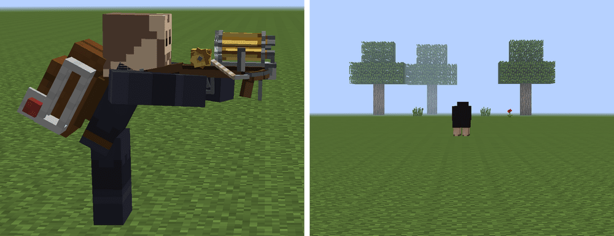

## Tips

- Keep magazines and ammunition in the hotbar. Both are looked up there first.
- Carry two or three loaded magazines. A reload takes a second and a half, and a spent magazine is not lost.
- The crossbow does not break by default. A server can set a number of shots after which it breaks. A magazine inside it comes back to your inventory when it breaks.

## Configuration

The size of the magazine, the loading pause and the two magazine recipes are in [Crossbow Magazine](Configuration#crossbow-magazine-crossbowmagazine). The list of ammunition and the damage of Crossbow Bolts are in [Ammunition](Configuration#ammunition-crossbowammo). The pause between bolts, the reload time, damage, speed, the recoverable bolts and the wear are in [Clockwork crossbow](Configuration#clockwork-crossbow-crossbow). The hook has its own numbers (range, speed, cooldown, cost) in [Grappling hook](Configuration#grappling-hook-crossbowgrapple), and the sniper mode in [Sniper mode](Configuration#sniper-mode-crossbowsniper). Each mode has a switch.

## See also

[Controls](Controls), [Configuration](Configuration)
