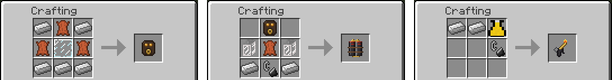
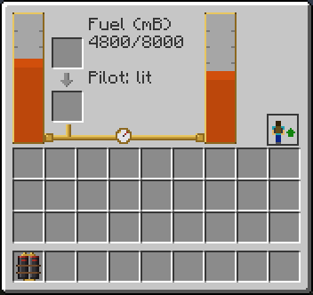
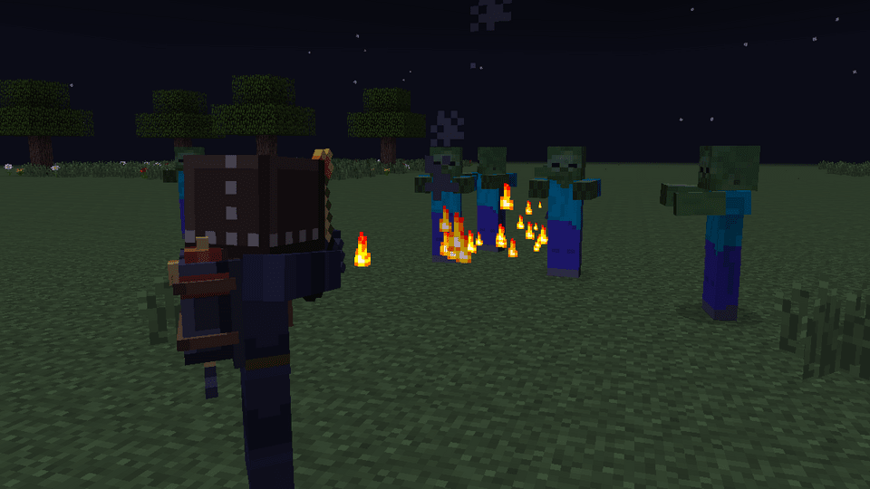

# Flamethrower

A weapon in two pieces. The Flamethrower Pack goes on your back, with two fuel tanks and a pyro mask drawn on your head. The Flamethrower is the nozzle you hold: with the pack lit, hold right click and it throws flame in a cone in front of you. The pack goes in the same place on your back as a backpack, so you wear one of them at a time.

| | |
|---|---|
| Type | Wearable item (Flamethrower Pack) and held item (Flamethrower) |
| Stack size | 1 |
| Obtained by | Crafting |
| Config section | `flamethrower`, `enabled.flamethrower`, `fuels`, `recipes.flamethrower` |

The pack burns the liquid fuels of the [fuel list](Fluids-and-Hose#fuels): BuildCraft fuel and oil, Forestry bioethanol and biomass, Railcraft creosote, GregTech diesel and others. Without a mod that brings one of them there is nothing to burn, and the pack, the mask and the nozzle have no recipe and are hidden.

## Crafting

- The Pyro Mask is a glass pane in leather, with an iron frame.
- The Flamethrower Pack is the mask, two Backpack Tanks, leather, iron ingots and a flint and steel, which is the pilot.
- The Flamethrower is two iron ingots, a Hose Nozzle and a flint and steel.

With a mod that brings metal plates, such as steel, there are extra recipes with plates in place of the iron ingots. With a mod that brings rubber, the mask can be made with rubber instead of leather. See [Compatibility](Compatibility#rubber-electric-motors-and-metal-plates).

## Getting ready

1. Put the pack on. Hold it, right click in the air, and press Equip in the window. Once you wear it, B opens the window and the same button takes it off.
2. Fill the tanks. Each holds 4000 mB. Put a bucket or can of fuel in the container slots of the window, or fill the pack at a [Fuel Station](Fuel-Station), which does it in one click. Both tanks hold the same fuel; a different fuel is refused.
3. Light the pilot with Sneak + N. You get a message in chat. Press Sneak + N again to put it out.
4. Hold the Flamethrower in your hand and hold right click.

The pilot goes out by itself when you take the pack off, when you die, and when the tanks run dry. The nozzle fires only with the pack on and lit.

## What the flame does

Every burst, five times a second while you hold right click, hits every living thing in a cone in front of you:

| | Default |
|---|---|
| Reach | 6 blocks from your eyes |
| Cone | 25 degrees wide, around where you look |
| Damage | 2.0 per burst (one heart) |
| Fire | the target burns for 5 seconds |
| Fuel | 20 mB per burst |

- Minecraft gives a creature half a second of protection after a hit, so not every burst does damage. The fire keeps burning anyway. Creatures that do not burn, like blazes, take no damage.
- The flame needs a clear line. It does not go through walls.
- You never hurt or burn yourself.
- Other players are not hurt by default. A server can allow it; the server's PvP setting and teams still apply. Tamed animals you own are never hurt.
- Blocks do not catch fire by default. A server can allow it: each burst then puts fire on the side of the block it hits, like flint and steel, and only where you may build.
- The pilot costs no fuel by default.

### How long the fuel lasts

The cost of a burst is multiplied by the fuel: oil burns 1.5 times faster than fuel. With fuel, two full tanks of 4000 mB give 400 bursts, which is 80 seconds of continuous fire. With oil it is about 53 seconds. The left tank empties first. When the fuel runs out you get a message and the pilot goes out.

## Controls

| Action | Control |
|---|---|
| Open the window | B, or right click with the pack in hand |
| Put on, take off | The button of the window |
| Light and put out the pilot | Sneak + N |
| Fire | Hold right click with the Flamethrower in hand |

## Tips

- Light the pilot before the fight. It costs no fuel by default, and with empty tanks it does not light.
- Reach is short, 6 blocks. Back away while you fire.
- Keep a spare container of fuel in the window of the pack, or a Fuel Station at camp.

## Dying

The pack drops where you died. With a grave mod it goes into the grave. See [FAQ](FAQ#what-happens-when-i-die).

## Configuration

The reach, cone, damage, fire time, fuel per burst, tank size, PvP and block fire are in [Configuration](Configuration#flamethrower-flamethrower).

## See also

[Fuel Station](Fuel-Station), [Fluids and Hose](Fluids-and-Hose#fuels), [Gear](Gear), [Controls](Controls)
