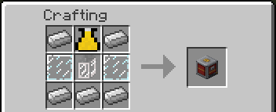
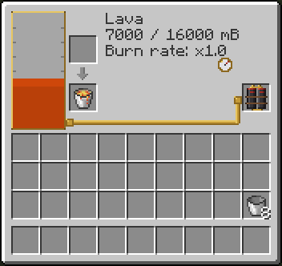

# Fuel Station

A block with a fuel tank. It fills the Flamethrower Pack, the Copter Pack and the Motorized Inflatable Boat in one click, takes fuel from buckets, cans and pipes, and works with hoppers and redstone comparators.

| | |
|---|---|
| Type | Block |
| Obtained by | Crafting |
| Config section | `fuelstation`, `enabled.fuelStation`, `fuels`, `recipes.fuelstation` |

> Screenshot: a Fuel Station placed next to a Motorized Inflatable Boat on the shore. File: images/fuelstation-1.png

## Crafting

It is made of iron ingots, glass panes, a Hose Nozzle and a Backpack Tank. With a mod that brings metal plates, such as steel, there is an extra recipe with plates in place of the iron ingots. See [Compatibility](Compatibility#rubber-electric-motors-and-metal-plates).

## What it holds

The tank holds 16000 mB of one fuel at a time. It takes only the fuels of the [fuel list](Fluids-and-Hose#fuels), and only one kind until it is empty again.

There are three ways to fill it:

- **Containers.** Right click the station to open its window. Put a bucket, can or cell of fuel in the input slot: the fuel goes into the tank and the empty container comes out in the output slot. An empty container in the input slot is filled from the tank.
- **Pipes.** A pipe or machine of another mod can fill the station with fuel from any side, and take fuel out of it. It only takes fuels of the list.
- **Hoppers.** A hopper puts containers in the input slot from the top and from the sides, and takes the empty ones from the bottom. The slot for packs is only for players.

A redstone comparator next to the station reads how full the tank is, from 0 to 15.

If you break the station, its slots drop and the block keeps its fuel: the item you get shows how much in its tooltip, and the fuel is there again when you place it. A creative player breaking it gets the slots back and not the block.

## What it fills

Every transfer moves all that fits, at once.

| What | How |
|---|---|
| The Flamethrower Pack or the Copter Pack in the pack slot | Put the pack in the slot of the window. It fills at once, and again each time the station gets more fuel. |
| The pack you wear or hold | Sneak and right click the station. |
| The Motorized Inflatable Boat | Sit in the boat and right click the station. |

You get a message in chat with how much moved. The message says so when the station is empty, or when the pack or the boat is full or holds another fuel. A pack or boat that holds one fuel takes only that fuel.

> Screenshot: a player on the Motorized Inflatable Boat next to the Fuel Station, with the chat message of the fuel moved. File: images/fuelstation-4.png

The fuels burn at different rates; a Fuel Station does not change that. The rates are in [Fluids and Hose](Fluids-and-Hose#fuels).

## Controls

| Action | Control |
|---|---|
| Open the window | Right click |
| Fill the pack you wear or hold | Sneak + right click |
| Fill the boat you ride | Right click, riding the boat |

## Configuration

The tank size is `fuelstation.tankCapacity`. The switch is `enabled.fuelStation`. With it off the block has no recipe, is hidden, and takes and gives nothing. See [Configuration](Configuration#fuel-station-fuelstation).

## See also

[Flamethrower](Flamethrower), [Jetpack and Copter Pack](Jetpack-and-Copter-Pack), [Gear](Gear#motorized-inflatable-boat), [Fluids and Hose](Fluids-and-Hose#fuels)
