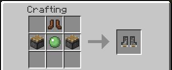
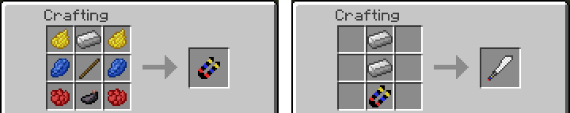
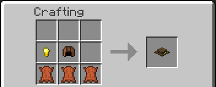
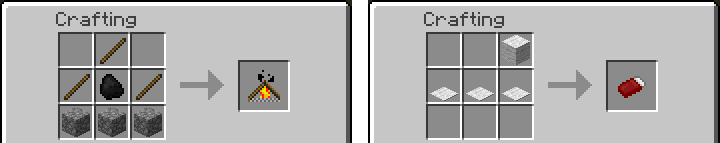
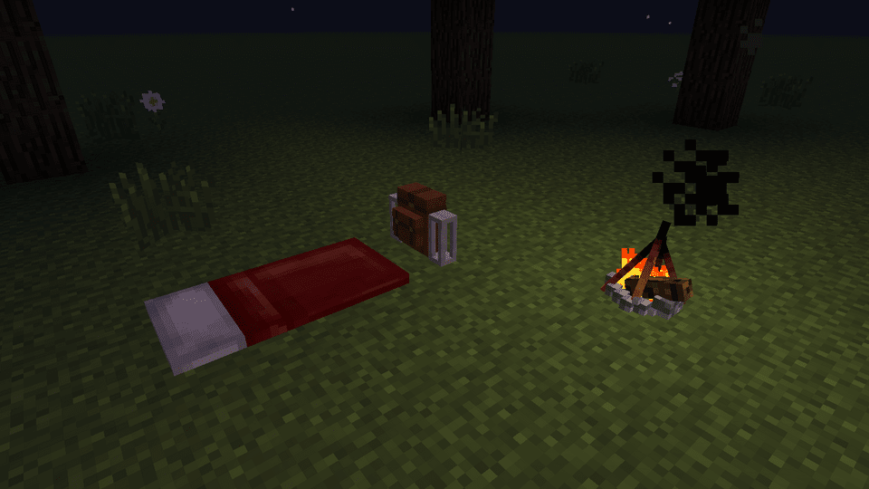
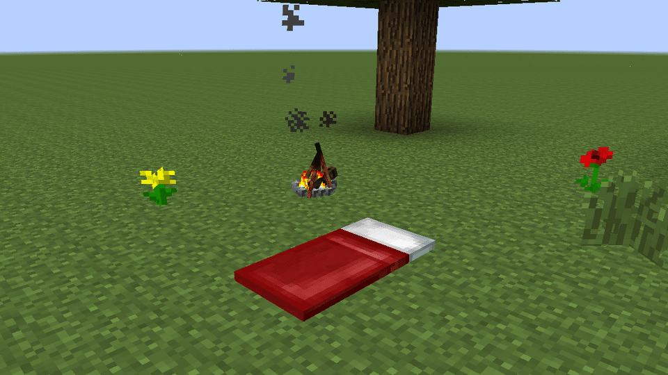
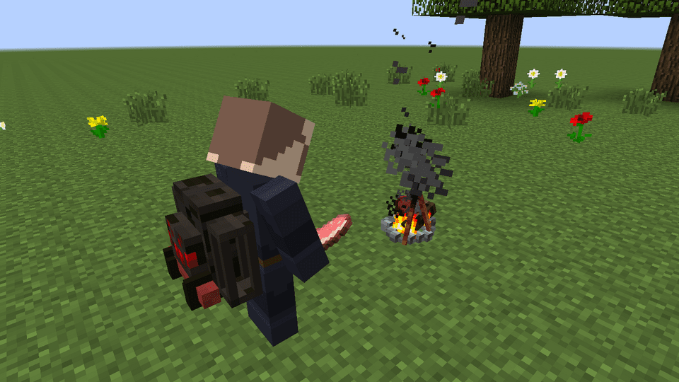
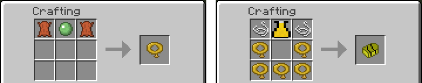
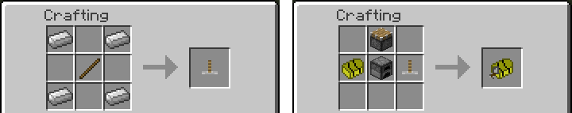
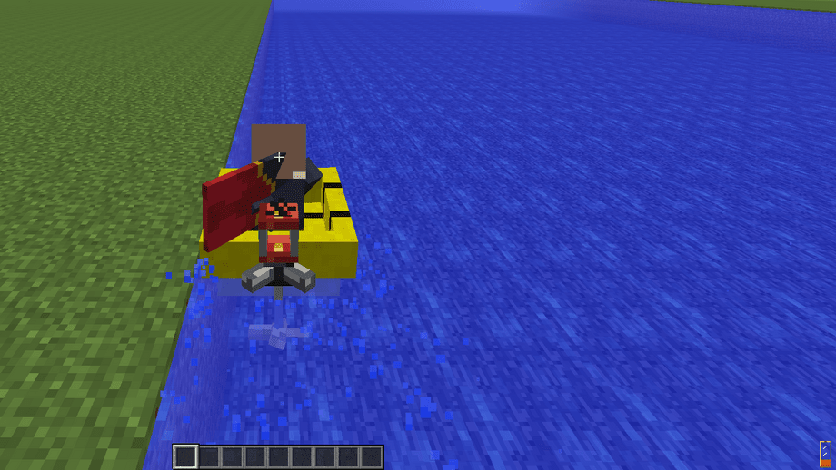

# Gear

The smaller items of the mod: boots, a machete, a hat, the campfire and sleeping bag that make a camp, and the inflatable boat with its outboard motor. It also tells how to [put the back gear on the ground](#placing-gear-on-the-ground). The backpacks, the hose, the crossbow, the flying packs, the [Scuba Gear](Scuba-Gear), the [Flamethrower](Flamethrower) and the [Fuel Station](Fuel-Station) have their own pages.

## Piston Boots

| | |
|---|---|
| Type | Boots |
| Obtained by | Crafting |
| Config section | `pistonboots`, `enabled.pistonBoots` |

Wearing them you:

- step up full blocks while sprinting, without jumping (a server can let the boots step up at any pace, walking included)
- get Speed I while sprinting
- jump a little higher, with a piston sound
- leap farther when you jump while sprinting: the jump keeps your speed and adds to it, up to a limit
- take no damage from falls shorter than 8 blocks

They give 2 armor points, like iron boots.

The step height, the speed, the fall distance, the leap and when the boots step up are in [Configuration](Configuration#piston-boots-pistonboots).

## Machete

| | |
|---|---|
| Type | Tool |
| Obtained by | Crafting |
| Config section | none |

The machete is made of two iron ingots and a Machete Handle, and the handle has its own recipe.

It cuts through plants fast: leaves, grass, flowers, cobwebs, pumpkins, melons, mushrooms, cactus, cocoa, sugar cane, lily pads, hay bales, wool and crops. It also shears leaves, grass and vines the way shears do, so you get the blocks themselves.

## Adventurer's Fedora

| | |
|---|---|
| Type | Helmet |
| Obtained by | Crafting |
| Config section | none |

A hat. It gives 2 armor points, the same as an iron helmet, and has no other effect.

## Campfire and sleeping bag

| | |
|---|---|
| Type | Blocks |
| Obtained by | Campfire: crafting. Sleeping Bag: crafting |
| Config section | `enabled.sleepingBag`, `sleepingbag`, `enabled.campfire`, `campfire.cooking` |

### Making a camp

There are two ways to get a sleeping bag on the ground.

- From a placed backpack. Place the backpack and open it. Press the sleeping bag button, and the bag unrolls next to the backpack, if there is free space and solid ground for it. You get a chat message if it does not fit. Press the same button to roll it up again. If you pick up the backpack, the bag rolls up with it.
- On its own. Hold the Sleeping Bag item and right click the top of a block. The bag lies on the ground like a bed, with its head away from you. It needs two free blocks with solid ground under them. Break it to get the item back, or sneak and right click it to roll it up into your inventory.

Then:

1. Place a Campfire within 8 blocks of the bag.
2. Right click the bag to sleep.

After you wake up in a bag, if you die you respawn at the campfire you slept next to. If there is no campfire, you respawn at the bag, as with a bed. If you sleep in a normal bed, the usual bed rules come back.

A server can make the bags not move your spawn point, so you keep the spawn you had. See [Configuration](Configuration#sleeping-bag-sleepingbag).

The Sleeping Bag item is also one of the parts of the Standard backpack recipe.

### Cooking on the campfire

Right click the campfire with raw food in your hand and the food goes on the fire. It cooks in ten seconds, one item after another, and the result comes into your inventory if you stand within 4 blocks. If you are farther away, it pops out on top of the fire. The campfire takes up to 8 items of one kind at a time. The rest stays in your hand. It cooks what a furnace cooks into food: raw meat, fish and potatoes. Other recipes, like ores, are off by default.

If the fire is full or busy with another item, you get a chat message. If you break the campfire, the raw items on it drop. The campfire does not need fuel.

The time, the number of items, the range and whether it cooks more than food are in [Configuration](Configuration#campfire-cooking-campfirecooking).

## Inflatable boat

| | |
|---|---|
| Type | Item |
| Obtained by | Crafting |
| Config section | `inflatableboat`, `enabled.inflatableBoat`, `recipes.boat` |

The Inflatable Boat is built from parts, and the parts have their own recipes: Inflatable Chambers, a Hose Nozzle as the valve, and string. The Motorized one adds an outboard engine and Hydro Blades.

With only vanilla items, a chamber is made of leather and a slimeball, and the motor is a piston and a furnace. If another mod brings rubber or an electric motor, there are more recipes:

- Three rubber make two Inflatable Chambers. Rubber is searched by the names `itemRubber`, `plateRubber` and `ingotRubber`, which IndustrialCraft 2 and GregTech use.
- The Motorized Inflatable Boat can be made from an Inflatable Boat, Hydro Blades and an electric motor, instead of a piston and a furnace. The motors it looks for are the IndustrialCraft 2 Electric Motor, the GregTech LV Motor, any item named `craftingElectricMotor`, and the Thermal Expansion Redstone Reception Coil.

A pack can choose between the vanilla recipes only, both, or the mod parts replacing the vanilla ones, and change the lists. See [Configuration](Configuration#extra-recipes-recipes).

Right click on water to put a boat down. Its top speed is the same as the vanilla boat by default and can be raised in [Configuration](Configuration#inflatable-boat-inflatableboat). Break the boat to pick it up again; you get the item back, with the fuel of its motor if it has any.

### Motorized Inflatable Boat

The Motorized Inflatable Boat has an outboard motor that burns fuel and makes it faster. Without fuel, or with the motor off, it moves like the plain boat.

| | Plain boat | Motor on |
|---|---|---|
| Top speed | 7 blocks per second | 12 blocks per second |
| Speeds up | like the vanilla boat | twice as fast |

**Starting the motor**

1. Fill the tank at a [Fuel Station](Fuel-Station): sit in the boat and right click the station. The tank holds 6000 mB.
2. The motor goes with the Change Mode key, G by default. You can change it in Options > Controls.
3. Sit in the boat on water and press the key. You hear the pull of a cord and the motor starts.
4. Steer with the move keys. The boat goes ahead by itself while the motor runs; holding back still brakes.
5. Press the key again to stop. The motor coughs and goes quiet.

The motor does not start without fuel, or when the boat is not on water. The tank shows on screen while you ride.

If you prefer, `inflatableboat.motor.mode` can be changed to `hold`. The motor then pushes only while you hold the forward key, and Change Mode does nothing in the boat.

**Sound**

The motor is told by sound, not by chat. While it runs you hear a looping putt-putt that follows the boat, a little lower and quieter at a standstill and louder at full speed. It starts with the pull of a cord and ends with a cough. The same sounds play when the motor stops by itself, because the fuel ran out or the boat left the water.

- `inflatableboat.motor.soundVolume` sets the volume, from 0.0 to 1.0.
- `inflatableboat.motor.sound` set to false makes the motor silent.
- `inflatableboat.motor.messages` brings back the chat messages (on, off, out of fuel, not on water), for players who cannot hear. It is off by default.

The three sounds are public domain recordings from Freesound, credited in the file `CREDITS-sounds.txt` inside the mod.

**Fuel**

The motor burns the fuels of the [fuel list](Fluids-and-Hose#fuels). With fuel a full tank of 6000 mB lasts about 5 minutes of running. Oil burns faster: about 3 minutes 20 seconds. The tank takes one fuel at a time.

The motor stops by itself:

- when the fuel runs out
- when the pilot gets off
- when the boat has been out of the water for half a second, on land or in the air over a wave

The fuel goes with the item when you pick the boat up, and is in the tank again when you put the boat down.

The speed, the acceleration, the fuel per tick, the tank size, the mode and the sound are in [Configuration](Configuration#boat-motor-inflatableboatmotor).

## Placing gear on the ground

The Steam Jetpack, the Copter Pack, the Scuba Gear and the Flamethrower Pack can be put down like a backpack and stand on the ground as a block.

- **Put it down:** hold the gear, sneak and right click the top of a block. Right click in the air still opens its window.
- **Open it:** right click the placed gear. Its usual window opens, without the equip button and the ON/OFF switch: fill the tanks with buckets, put fuel in the jetpack's firebox slot.
- **Pick it up:** break it, or sneak and right click it with an empty hand. Sneaking puts it straight on your back when the back slot is free; otherwise it goes into your inventory. In creative, breaking it without sneaking does not drop it.
- **Nothing is lost:** the gear keeps everything it holds (water, steam, fuel, air, the firebox, its name). Pistons cannot move it and explosions do not break it.
- **It does not run:** the jetpack's boiler stays as you left it, at the same temperature, until you pick it up. The copter's engine and the pilot flame are off.
- **Pipes:** pipes and tanks of other mods can fill a placed gear from any side: water into the jetpack, fuels of the [fuel list](Fluids-and-Hose#fuels) into the copter and the flamethrower, air into the scuba. Steam can be taken out of the jetpack.

A server or a modpack can turn this off for all the gear or for each one. See [Configuration](Configuration#placed-gear-placedgear).

## See also

[Backpacks](Backpacks), [Scuba Gear](Scuba-Gear), [Flamethrower](Flamethrower), [Fuel Station](Fuel-Station), [Configuration](Configuration)
