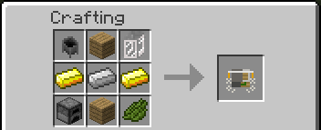
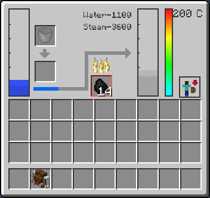
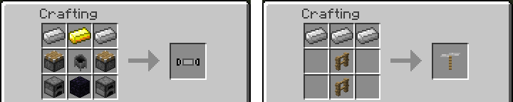
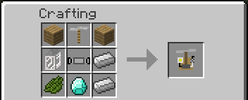
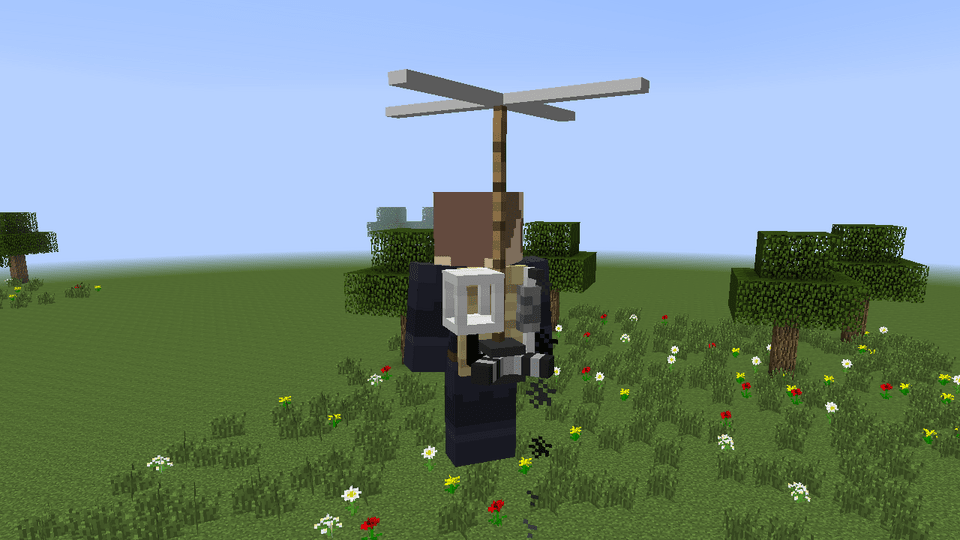

# Jetpack and Copter Pack

Two ways to fly. The Steam Jetpack boils water and thrusts up while you hold jump. The Copter Pack burns fuel to turn a rotor, and lets you glide, climb and hover. Both are worn on your back, in the same place as a backpack, the Scuba Gear and the Flamethrower Pack, so you wear one of them at a time.

Flying is meant to cost. With the default settings a full tank gives about one to two minutes of flight, so you plan the trip and carry fuel or water.

## Steam Jetpack

| | |
|---|---|
| Type | Wearable item |
| Stack size | 1 |
| Obtained by | Crafting |
| Config section | `steamjetpack`, `enabled.steamJetpack` |

### Crafting

> Screenshot: the crafting table with the Steam Jetpack recipe made with the Railcraft firebox and boiler tank. File: images/jetpack-2.png

The recipe uses a firebox and a boiler. Without Railcraft they are a furnace and a cauldron. With Railcraft they are its solid fuel firebox and low pressure boiler tank. The rest is a Backpack Tank, gold ingots, an iron ingot, planks and green dye.

The boiler needs a fluid called steam. If another mod (Railcraft, IndustrialCraft 2) provides one, the jetpack uses it. If not, the mod adds its own steam, so the jetpack works alone.

### How it works

Open the jetpack window with B while you wear it. It has a water tank with bucket slots, a slot for fuel, the boiler temperature in degrees and the steam tank.

1. Put water in the water tank. Buckets work, and swimming also fills it slowly.
2. Put a furnace fuel in the fuel slot: coal, charcoal, wood.
3. Press Sneak + N to turn the jetpack on. The firebox starts burning and the boiler heats up.
4. Wait for the boiler to pass 100 degrees. Then water turns into steam, 1 mB of water for 4 of steam.
5. Hold jump to thrust.

Thrust costs 20 mB of steam per tick, and the first moment of each thrust costs 150 mB more. With the default tanks:

| Situation | How long |
|---|---|
| Full steam tank (12000 mB) | 30 seconds of thrust |
| Full steam tank and full water tank (6000 mB) | about 90 seconds of thrust |
| One piece of coal | about 27 seconds of thrust |
| Boiler from 25 to 100 degrees | about 1 minute |
| Boiler cooling from 200 to 100 degrees without fire | about 3 minutes 20 seconds |

While you thrust the boiler loses heat. With the fire lit it keeps up; without fuel a long flight drops it below the boiling point in under a minute. Thrust lifts you at up to about 5.6 blocks a second, and it fades out above Y 90.

### Controls

| Action | Control |
|---|---|
| Open the window | B |
| Turn on and off | Sneak + N |
| Thrust | Hold jump |
| Move sideways in the air | Move keys |

## Copter Pack

| | |
|---|---|
| Type | Wearable item |
| Stack size | 1 |
| Obtained by | Crafting, with a mod that brings a fuel |
| Config section | `copterpack`, `enabled.copterPack`, `fuels` |

The Copter Pack burns liquid fuel, and it does not need a particular mod: any loaded mod that brings a fuel of the [fuel list](Fluids-and-Hose#fuels) will do. BuildCraft fuel and oil, Forestry bioethanol and biomass, Railcraft creosote and GregTech diesel are some. With none of them the item is registered, in the creative tab, but has no recipe and does nothing, so worlds stay compatible.

### Crafting

The pack is made from two components, Copter Blades and a Two-Cylinder Diesel Engine, plus a Backpack Tank, planks, green dye, a diamond and iron.

### Fuel

Open the copter window with B and put fuel in its tank with a bucket or a can, or fill it at a [Fuel Station](Fuel-Station): put the pack in the station's slot, or sneak and right click the station with the pack in your hand or on your back. The tank holds 6000 mB of one fuel at a time.

Each fuel burns at its own rate: oil 1.5 times as fast as fuel, creosote 1.8 times, coal 0.8 times. The table is in [Fluids and Hose](Fluids-and-Hose#fuels), and the times below are for fuel, which is 1.0. A modpack can add fluids to the list.

### Flying

1. Press Sneak + N to start the engine. It takes 100 mB of fuel to start, and it does not start with less in the tank.
2. Jump to climb. Sneak to come down.
3. Press N to switch between normal mode and hover.

In normal mode you fall slowly, at 60 percent of the usual speed, and take no fall damage. In hover mode you stay at your height and move sideways; you still climb and descend with jump and sneak. The rotor blows dropped items away from you.

With the default settings and Fuel, a full tank (6000 mB) lasts:

| Mode | How long |
|---|---|
| Gliding | about 2 minutes 30 seconds |
| Hovering | about 75 seconds |
| Climbing | about 75 seconds |
| Climbing while hovering | about 50 seconds |

You climb at about 3 blocks a second and move up to about 11 blocks a second sideways. Lift fades out above Y 90, so you stop around Y 105; hover keeps any height you already reached.

The engine stops in water. If the tank runs dry on the ground it switches off. If it runs dry in the air, hover mode falls back to normal mode so you glide down, and you cannot climb.

### Controls

| Action | Control |
|---|---|
| Open the window | B |
| Start and stop the engine | Sneak + N |
| Normal mode and hover | N |
| Climb | Hold jump |
| Descend | Sneak |

## Dying while you fly

The copter pack and the jetpack always drop where you died, like the Scuba Gear and the Flamethrower Pack. With a grave mod they go into the grave. See [FAQ](FAQ#what-happens-when-i-die).

## Tips

- Gliding is the cheapest way to fly. Hovering and climbing cost twice as much, so climb, then glide.
- Carry spare buckets of fuel or water and refill after you land.
- A server or a modpack can make flight cheaper or dearer. The values are in [Configuration](Configuration#copter-pack-copterpack) and [Configuration](Configuration#steam-jetpack-steamjetpack).

## See also

[Fluids and Hose](Fluids-and-Hose), [Fuel Station](Fuel-Station), [Compatibility](Compatibility), [Controls](Controls)
