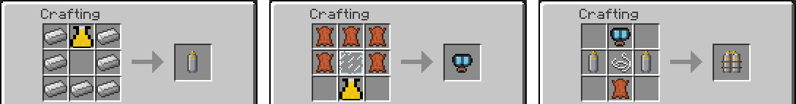
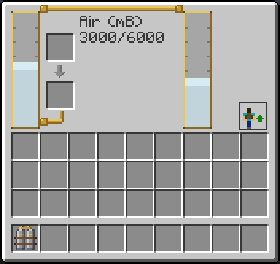
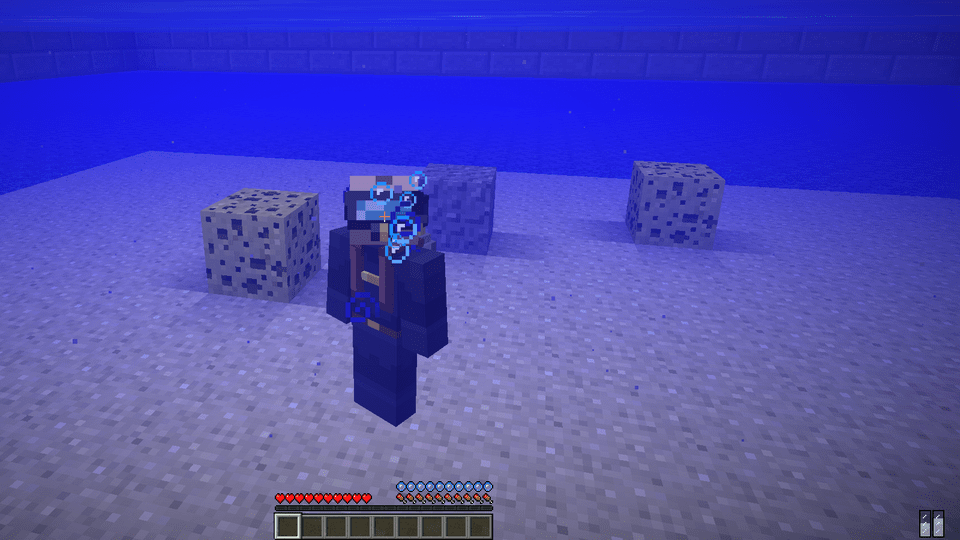
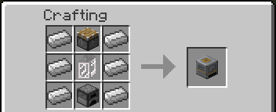
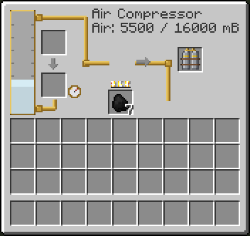

# Scuba Gear

Diving equipment for your back: two air tanks and a diving mask that is drawn on your head. While your head is under water and the tanks have air, your air bar stays full. The Air Compressor, a block, fills the tanks. The gear goes in the same place on your back as a backpack, so you wear one of them at a time.

## Scuba Gear

| | |
|---|---|
| Type | Wearable item |
| Stack size | 1 |
| Obtained by | Crafting |
| Config section | `scuba`, `enabled.scuba` |

### Crafting

The gear is made from a Diving Mask, two Air Tanks, string and leather. An Air Tank is an iron bottle with a Hose Nozzle as its valve. The Diving Mask is a glass pane in leather, with a Hose Nozzle as the regulator. If a loaded mod brings rubber, there is a second mask recipe with rubber instead of leather. See [Compatibility](Compatibility#rubber-electric-motors-and-metal-plates).

The recipes exist when some breathable fluid exists: the mod adds its own Air, or another mod brings air or oxygen. See [Fluids and Hose](Fluids-and-Hose#air).

### Putting it on

Hold the gear and right click in the air. The window opens, and the Equip button puts it on your back. Once you wear it, B opens the window and the button takes it off. The mask shows on your head and the tanks on your back.

The window has the two tanks, shown as "Air: amount / capacity", and an input and an output slot for containers. A full container of air or oxygen puts its fluid in the tanks and comes out empty; an empty container is filled from the tanks. Items that hold air without being fluid containers, like the IndustrialCraft 2 Compressed Air Cell, work too. Each tank holds 3000 mB.

### Breathing under water

While your head is under water and the tanks have air, the gear keeps your air bar full and spends 10 mB of air per second. It empties the left tank first.

| Situation | How long |
|---|---|
| Both tanks full (6000 mB) | 10 minutes |
| One tank full (3000 mB) | 5 minutes |
| From the low air warning (600 mB) | about 1 minute |

- The gear spends air only when your air bar would go down. With a Water Breathing potion or a Squid or Dragon backpack on, it spends nothing.
- Out of water it spends nothing.
- When the air falls under 600 mB you get a message in chat and a click, once for each dive. When it runs out you get another message, and you have the normal air bar of Minecraft to swim up. The gear does not hurt you.
- Bubbles rise from the mask while you breathe from the tanks, for you and for the players who see you.

### Filling the tanks

Three ways:

1. Put the gear in the slot of an Air Compressor. It fills in a few seconds. See below.
2. Sneak and right click an Air Compressor with the gear in your hand, or with an empty hand while you wear it.
3. Put containers of air or oxygen in the window of the gear: GregTech Air Cells, oxygen cells and cans of other mods, and the IndustrialCraft 2 Compressed Air Cell.

Oxygen counts as air. Where the tanks take the fluid called oxygen, they keep it as air. The list of fluids they take is `scuba.breathableFluids`.

### Controls

| Action | Control |
|---|---|
| Open the window | B, or right click in the air with the gear in hand |
| Put on, take off | The button of the window |

### Putting it down

Sneak and right click the top of a block with the gear in hand to put it on the ground. Right click it to open its window, break it or sneak and right click it with an empty hand to pick it up. Pipes of other mods can fill its tanks with air or oxygen. See [Gear](Gear#placing-gear-on-the-ground).

### Dying

The gear drops where you died. With a grave mod it goes into the grave. See [FAQ](FAQ#what-happens-when-i-die).

## Air Compressor

| | |
|---|---|
| Type | Block |
| Obtained by | Crafting |
| Config section | `scuba.compressor`, `enabled.scuba` |

The Air Compressor makes air with a hand pump or by burning a furnace fuel, keeps it in a tank of 16000 mB, and fills the Scuba Gear.

It is made of iron, a piston, a Backpack Tank and a furnace.

### Making air

- **Hand pump.** Right click it with an empty hand. Each click adds 100 mB, with a short wait of 4 ticks between clicks. Sixty clicks fill a Scuba Gear.
- **Furnace.** Put any furnace fuel in the fuel slot: coal, charcoal, wood. While it burns it makes 10 mB of air per tick, so one coal makes 16000 mB, a full tank. It lights the next fuel when the tank has room.
- **Pipes.** A pipe or machine of another mod can push air or oxygen into the compressor from any side, and take air out of it.

The hand pump and the furnace need open air: the block above the compressor must be air. Buried or under water it makes none, so it is not an air source for an underwater base. Air from pipes is taken anyway. If the pump has no air above it you get a message in chat.

### Filling the gear

| You | Result |
|---|---|
| Put the Scuba Gear in the gear slot | The compressor moves 50 mB per tick into it, until it is full or the tank is empty. An empty gear fills in 6 seconds. |
| Sneak and right click, empty hand | Fills the gear you wear with all the air that fits. A message tells you how much. |
| Sneak and right click, gear in hand | Fills the gear in your hand in the same way. |
| Right click, item in hand | Opens the window. |

The window has the air tank, the fuel slot with the flame, the gear slot, and an input and output slot for containers. Full air containers empty into the tank, and empty ones are filled from it. This works with GregTech Air Cells and with the IndustrialCraft 2 Compressed Air Cell.

### Tips

- Keep the compressor on the surface with a pump or a furnace, and carry the gear down. One tank of 16000 mB fills the gear almost three times.
- Feed it a stack of fuel and it keeps making air as long as it has room.
- The amounts, the tank size and the open air rule are in [Configuration](Configuration#air-compressor-scubacompressor).

## See also

[Gear](Gear), [Fluids and Hose](Fluids-and-Hose), [Compatibility](Compatibility), [Configuration](Configuration#scuba-gear-scuba)
